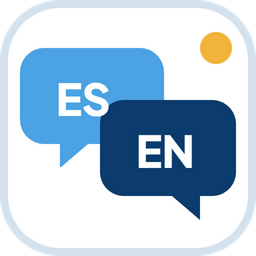
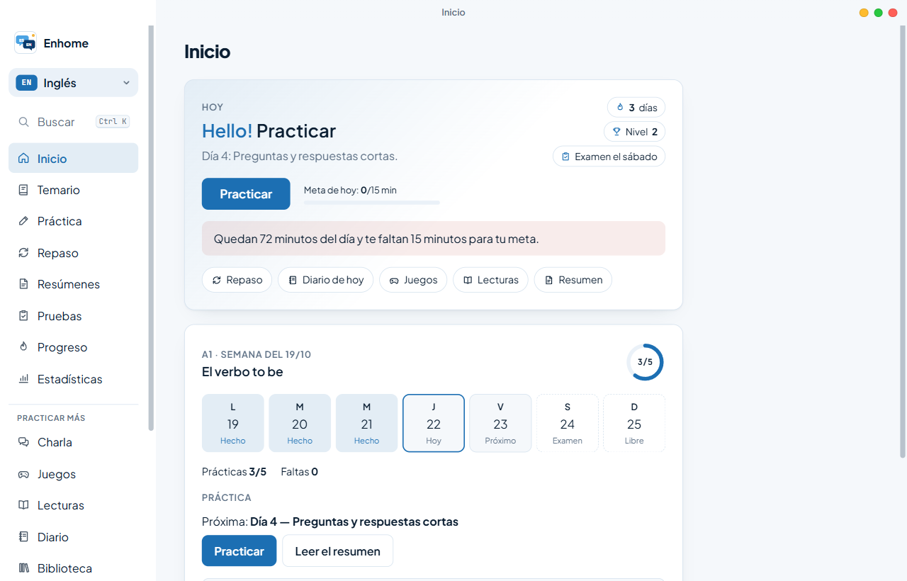
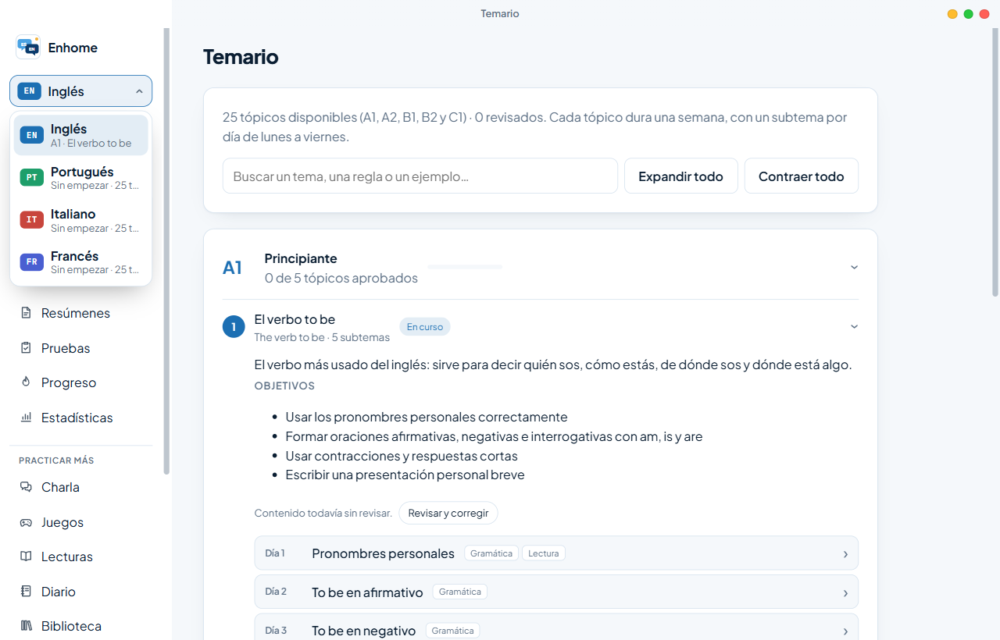
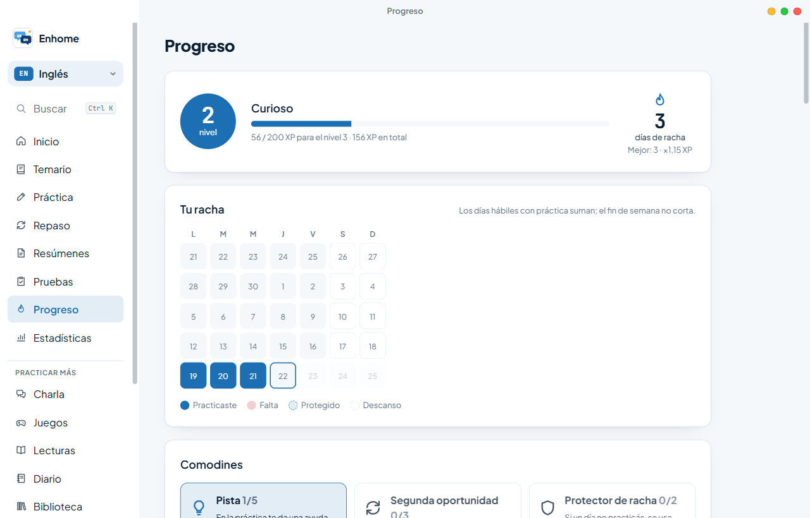
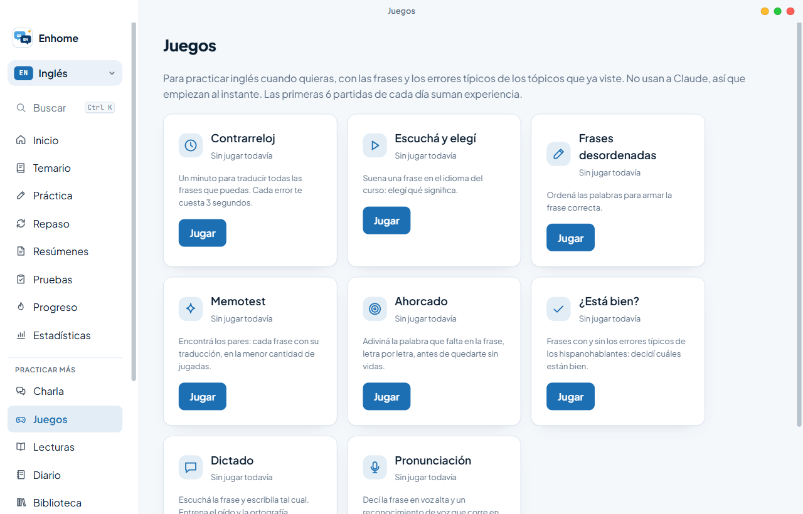
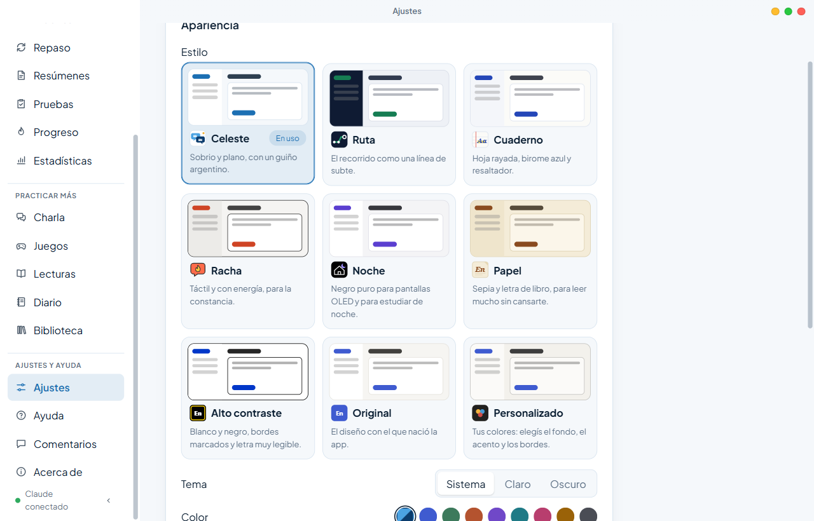
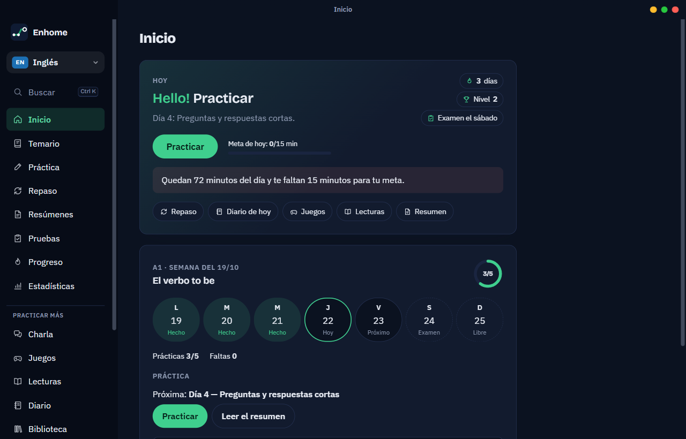
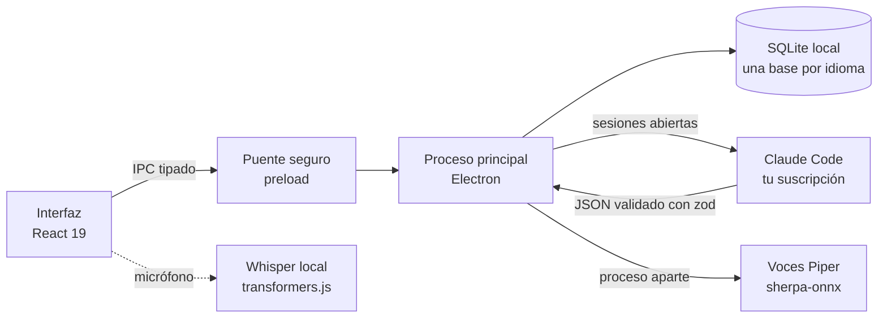

<div align="center">



# Enhome

### Aprendé idiomas en casa, de a un tópico por semana, con Claude de profesor particular.

App de escritorio para Windows con cursos de **inglés, portugués de Brasil, italiano y francés**, cada uno del nivel **A1 al C1** del marco europeo (MCER). Cada curso tiene práctica diaria realista —conversaciones, situaciones y tandas de traducción—, resúmenes a tu medida, juegos y exámenes semanales. Todo el material lo genera y lo revisa **Claude Code** con tu propia suscripción.

[](https://github.com/Fnqqew/enhome/actions/workflows/ci.yml)




[Qué hace](#qué-hace) · [Un día de práctica](#un-día-de-práctica) · [Juegos](#juegos) · [Estilos](#estilos-visuales) · [Instalar](#instalar) · [Cómo está hecha](#cómo-está-hecha) · [Novedades](#novedades)

</div>

---

## Qué hace

| | |
|---|---|
| 🌎 **Cuatro idiomas** | Inglés, portugués de Brasil, italiano y francés, de A1 a C1 (25 tópicos cada uno). Se cambia desde la barra lateral y cada curso tiene su propio progreso. |
| 🧭 **Examen inicial** | Te ubica en el temario según lo que ya sabés. Si nunca estudiaste el idioma, «Empezar desde cero» te lleva al primer tópico. |
| 🏠 **Qué hago hoy** | Inicio muestra una sola acción principal, la racha, la meta del día y cuánto falta para el examen. |
| 📅 **Recorrido semanal** | Un tópico por semana, un subtema por día de lunes a viernes, y el examen al final de la semana. Si faltás, el domingo podés recuperar; si algo no sale, hay semanas de refuerzo. Un curso se puede pausar sin perder la racha. |
| ✍️ **Práctica diaria** | Entre 5 y 10 ejercicios por día con 16 formatos distintos, con algo para escuchar y algo para decir en voz alta. Abre al instante con ejercicios ya escritos y revisados, y lo que corrige Claude llega mientras seguís con el siguiente. |
| 🔊 **Voz incluida** | Voces naturales para cada idioma y para el español, que se bajan solas la primera vez y funcionan sin internet. Las conversaciones se escuchan a dos voces. |
| 🔁 **Repaso** | Tus errores, palabras y frases vuelven justo antes de que se te olviden: el repaso (FSRS) aprende de lo que recordás. Después de cada examen podés revisarlo. |
| 🎮 **Juegos** | Ocho juegos que no usan a Claude, así que empiezan al instante (ver [Juegos](#juegos)). |
| 💬 **Charla, lecturas y diario** | Charlás con Claude en el idioma del curso, con cada mensaje corregido al costado. También hay lecturas graduadas a tu nivel y un diario que Claude corrige. |
| 📚 **Resúmenes** | 13 maneras de leer el mismo tema y un modo lectura cómodo, con índice y resaltados. Seleccioná cualquier texto para traducirlo, guardarlo o preguntarle a Claude. |
| 📝 **Pruebas** | Examen semanal, simulacros generales o por subtema e historial. Al terminar un nivel, recibís un certificado en PDF. |
| 🔥 **Progreso** | Racha, experiencia y niveles, comodines y logros, con gráficos y estadísticas. |
| 🎯 **Tu día** | Meta diaria en minutos o en actividades, recordatorio de Windows a la hora que elijas, ícono en la bandeja y arranque con Windows. |
| 🎨 **Personalización** | 9 estilos completos, entre ellos uno con tus propios colores. Además: modo claro y oscuro, 8 colores de acento, 3 tipografías, tamaño, espaciado, animaciones y sonidos. |
| 💾 **Tus datos** | Copia de seguridad automática diaria. Podés exportar e importar todo el progreso y borrar los datos cuando quieras. |

<table>
  <tr>
    <td></td>
    <td></td>
  </tr>
  <tr>
    <td align="center"><sub>Cuatro cursos, cada uno con su progreso</sub></td>
    <td align="center"><sub>Progreso y racha</sub></td>
  </tr>
</table>

## Un día de práctica

El día tiene cuatro partes:

1. **Calentamiento:** hasta 5 errores del cuaderno que tocan hoy.
2. **Microlección:** la regla, ejemplos para escuchar, los errores típicos de hispanohablantes y una pregunta para comprobar que se entendió.
3. **Práctica.**
4. **Cierre:** qué trabajaste, qué pasó al cuaderno, qué vuelve mañana y un juego rápido.

Cada práctica va de lo más guiado a lo más abierto. Siempre incluye una tanda de traducción y una conversación o una situación real y, desde 8 ejercicios, algo para escuchar y algo para decir en voz alta. Los días de lectura o escritura también suman ese formato. A medida que subís de nivel hay menos opción múltiple y más ejercicios en los que tenés que escribir la respuesta. La cantidad de ejercicios (5, 8 o 10) y los formatos que no te sirven se eligen en Ajustes.

| Formato | Qué hacés | Quién corrige |
|---|---|---|
| Opción múltiple · Completar · Ordenar · Corregir el error | Practicás la gramática del subtema en oraciones con contexto. | La app, al instante. Acepta errores de tipeo. |
| Traducir | Traducís una oración completa del español al idioma del curso. | La app, si coincide con una referencia; si no, Claude. |
| Transformar | Pasás una oración a otra forma: a pasado, a pregunta, a pasiva, a estilo indirecto. Desde A2. | La app, si coincide con una referencia; si no, Claude. |
| Dictado | Escuchás una oración (normal o más despacio) y la escribís. | La app, al instante. |
| Escucha | Escuchás una charla entre dos personas y respondés preguntas. | La app, al instante. |
| Pares mínimos | Escuchás una palabra y elegís cuál de dos muy parecidas era (*ship* o *sheep*). | La app, al instante. |
| Repetí | Escuchás una frase y la decís en voz alta. El reconocimiento de voz te marca qué palabras se entendieron. | La app, en tu compu. |
| Ordenar el texto | Ponés en orden las oraciones de un párrafo siguiendo sus conectores. Desde A2. | La app, al instante. |
| **Tanda de traducción** | Traducís una escena cotidiana contada en 3 o 4 oraciones encadenadas. | Claude, oración por oración. |
| **Conversación** | Completás tus turnos en un chat, según lo que pide cada consigna. | Claude, turno por turno. |
| **Situación real** | Resolvés un trámite, una compra o un reclamo con un objetivo y 3 o 4 pasos. | Claude, paso por paso, incluido el registro. |
| Comprensión lectora | Leés un texto adecuado a tu nivel y respondés preguntas. | La app, con puntaje parcial. |
| Escritura | Escribís un texto con una consigna concreta y un largo según el nivel. | Claude, con criterios ponderados. |

Si le errás a un ejercicio corto, te dice por qué no era y tenés un **segundo intento**. Si acertás, vale con menos puntaje. Si volvés a errar, pasa al cuaderno de errores y **vuelve al final** de la práctica para que lo fijes.

Durante la práctica podés hacer varias cosas:

- **cambiar** un ejercicio por otro equivalente;
- **volver** a uno anterior;
- **calificarlo**: los formatos que más te sirven aparecen más;
- pedir una **pista**, si tenés comodines.

Todo se maneja con el teclado y hay modo enfoque.

## Juegos

Usan las frases y los errores típicos de los tópicos que ya viste. Como no usan a Claude, empiezan al instante.

| Juego | Qué hacés |
|---|---|
| Contrarreloj | Traducís todas las frases que puedas en un minuto. |
| Escuchá y elegí | Escuchás una frase en el idioma del curso y elegís qué significa. |
| Frases desordenadas | Ordenás las palabras para armar la frase. |
| Memotest | Encontrás cada frase con su traducción. |
| Ahorcado | Adivinás la palabra que falta, letra por letra. |
| ¿Está bien? | Decidís qué frases tienen los errores típicos de los hispanohablantes. |
| Dictado | Escuchás la frase y la escribís tal cual. |
| Pronunciación | Decís la frase en voz alta y un reconocimiento de voz que corre en tu computadora te dice qué entendió. |



## Estilos visuales

| Estilo | Idea |
|---|---|
| **Celeste** | Sobrio y plano, con un guiño argentino. Es el predeterminado. |
| **Ruta** | El recorrido como una línea de subte, con un color por nivel. |
| **Cuaderno** | Hoja rayada, birome azul y resaltador. |
| **Racha** | Táctil y con energía: bordes marcados y botones que se hunden. |
| **Noche** | Negro puro para pantallas OLED y para estudiar de noche. |
| **Papel** | Sepia y letra de libro, para leer mucho sin cansarse. |
| **Alto contraste** | Blanco y negro, bordes marcados y letra muy legible. |
| **Original** | El diseño con el que nació la app. |
| **Personalizado** | Elegís el fondo, el acento y los bordes; la app ajusta el contraste del texto. |

El estilo pinta toda la app, también la barra de la ventana. Además, cambia el ícono de la barra de tareas y el de los accesos directos, que lo conservan con la app cerrada.

<table>
  <tr>
    <td></td>
    <td></td>
  </tr>
  <tr>
    <td align="center"><sub>Los nueve estilos</sub></td>
    <td align="center"><sub>Inicio · Ruta · oscuro</sub></td>
  </tr>
</table>

## Instalar

**Requisitos**

- Windows 10 u 11.
- [Claude Code](https://claude.com/claude-code) instalado y con sesión iniciada en una suscripción de claude.ai (Pro o superior). Sin eso, la app muestra una pantalla de bloqueo. Si Claude Code está en otra ruta, indicala con la variable `CLAUDE_PATH`.
- Unos 200 MB libres para las voces, que se bajan solas la primera vez (entre 60 y 130 MB cada una). Si preferís las voces de Windows, se eligen en *Ajustes → Voz*.
- Node.js 24 o superior, solo para compilar.

```powershell
npm install
npm run dist          # genera dist/enhome-<versión>-setup.exe
npm run update-local  # compila e instala encima de la versión instalada, y la vuelve a abrir
```

El instalador crea los accesos directos. Para actualizar:

- con el repositorio a mano, corré `npm run update-local`;
- desde la app, entrá a *Acerca de → Buscar actualizaciones*. Como el repositorio es privado, hace falta la [CLI de GitHub](https://cli.github.com/) con sesión iniciada (`gh auth login`).

> [!NOTE]
> La app instalada y la de desarrollo guardan el progreso en la misma carpeta (`%APPDATA%\enhome`), así que lo comparten. Cada idioma tiene su propia base de datos. Las copias automáticas quedan en `%APPDATA%\enhome\copias`.

> [!TIP]
> El instalador no está firmado. Si Windows lo bloquea con «Control de aplicaciones», permitilo desde *Seguridad de Windows*.

> [!WARNING]
> Si el repositorio está dentro de una carpeta de OneDrive, la sincronización puede borrar o bloquear `node_modules`, `out` y `dist` (ya pasó una vez). Lo más seguro es clonarlo fuera de OneDrive, por ejemplo en `C:\dev\enhome`.
>
> Si lo dejás ahí, hacé una de estas dos cosas:
>
> - marcá esas tres carpetas con clic derecho → *Mantener siempre en este dispositivo*;
> - corré `attrib +P node_modules /S /D` desde la carpeta del proyecto.

## Cómo está hecha



- **Nada de servidores ni API paga:** la app ejecuta el Claude Code instalado en tu compu. Lo único que sale de la máquina es lo que se le consulta a Claude.
- **Bancos de ejercicios:** cada subtema trae ejercicios cortos ya escritos y revisados (`banco.json`), así la práctica abre al instante y se corrige sin Claude. Cuando a un subtema le quedan pocos sin usar, la app escribe más en segundo plano.
- **Doble revisión:** un docente genera el material y un revisor lo corrige. Después, la app aplica sus propios controles antes de mostrar nada, y descarta lo que no los pasa.
- **Rápida:**
  - Claude trabaja en sesiones que quedan abiertas, con una cola de prioridades: corregir una traducción tarda unos 5 segundos;
  - a Claude se le manda solo lo que necesita para cada pedido;
  - lo que corrige Claude no frena: seguís con el siguiente ejercicio y la corrección aparece sola;
  - cada sección se carga recién cuando se usa.
- **Voz en tu compu:** las voces Piper corren con sherpa-onnx en un proceso aparte y cada frase queda guardada después de la primera vez. El reconocimiento de voz usa Whisper con transformers.js. Los modelos se bajan una sola vez.
- **Segura:** la interfaz corre aislada (sandbox) y la app instalada no puede arrancar como Node.
- **Calidad:**
  - 442 tests cubren el motor de progresión, la práctica, cada tipo de ejercicio, los exámenes, el repaso, las recompensas, los datos y los estilos;
  - `npm run content:check` revisa todo el temario y los bancos;
  - 9 pruebas de interfaz recorren la app con datos de prueba y un Claude simulado;
  - GitHub Actions corre todo en cada push.

<details>
<summary><strong>Desarrollo</strong></summary>

```powershell
npm run dev           # abre la app en modo desarrollo (con herramientas de prueba en Inicio)
npm run check         # tipos, linter, formato y tests, lo mismo que corre GitHub
npm run typecheck     # revisa tipos
npm run lint          # ESLint
npm run format        # Prettier
npm test              # tests
npm run e2e           # compila y recorre la interfaz con Playwright
npm run build         # compila sin generar el instalador
npm run content:check # revisa el temario y los bancos de ejercicios
npm run content:banks -- en A1   # escribe con Claude los bancos que faltan (idioma, nivel y tópico opcionales)
npm run icon          # regenera los íconos de los estilos desde src/shared/logos.json
```

Antes de cada commit, un hook (`.githooks/pre-commit`, que se activa con `npm install`) formatea con Prettier lo que se guarda y lo revisa con ESLint.

Las pruebas de interfaz usan dos variables, que también sirven para probar a mano sin tocar el progreso real:

- `ENHOME_DATA_DIR`: una carpeta de datos aparte;
- `ENHOME_CLAUDE_FALSO=1`: un Claude simulado que figura conectado pero no responde.

Pruebas contra Claude de verdad (gastan uso de la suscripción):

```powershell
$env:LIVE_CLAUDE = '1'; npx vitest run tests/live
```

> [!WARNING]
> Si la app no abre y aparece `Cannot read properties of undefined (reading 'isPackaged')`, la terminal tiene definida `ELECTRON_RUN_AS_NODE`. Pasa en las terminales integradas de VS Code: quitala antes de ejecutar `npm run dev`.

</details>

<details>
<summary><strong>Estructura del proyecto</strong></summary>

```
content/<idioma>/          temario de cada curso (en, pt, it, fr · A1 a C1), sus voces y el examen inicial; cada tópico con su banco.json
docs/                      documento base, planes de la 2.0 y la 3.0, y capturas
build/, resources/         íconos de la app, uno por estilo
scripts/                   íconos, bancos de ejercicios y actualización de la app instalada
src/main/                  proceso principal: bases, motor, Claude, práctica, resúmenes, pruebas, repaso, juegos, datos
src/preload/               puente seguro entre la interfaz y el proceso principal
src/renderer/src/styles/   base/ (estructura) · sections/ (cada sección) · styles.css (los estilos) · animations.css
src/renderer/              interfaz en React
src/shared/                tipos, esquemas y datos compartidos
tests/                     tests · tests/e2e: interfaz · tests/live: contra Claude real
```

</details>

## Novedades

**3.1.0** · El día con calentamiento, microlección y cierre, y Claude vuelve a crear los ejercicios de los tópicos sin banco.

**3.0.0** · Más rápida, con voz incluida y ejercicios para escuchar y hablar.

- La práctica abre al instante con ejercicios ya revisados, y Claude corrige en segundo plano en unos segundos.
- Voces naturales que se bajan solas, conversaciones a dos voces y reconocimiento de voz según tu compu.
- Seis formatos nuevos: dictado, escucha, pares mínimos, repetí en voz alta, transformar y ordenar el texto.
- Segundo intento con una pista, y lo que fallás vuelve al final de la práctica.
- Repaso con FSRS para errores, palabras y frases.

**2.0.0** · Cuatro idiomas completos y mucho más para practicar.

- Portugués de Brasil, italiano y francés, además de inglés. Cada uno va de A1 a C1 y tiene su propio progreso.
- Secciones nuevas:
  - Repaso, con errores que vuelven y tarjetas de vocabulario;
  - Juegos;
  - Charla, Lecturas y Diario;
  - Estadísticas, Biblioteca y Ayuda.
- Inicio con «qué hago hoy», meta diaria, recordatorio de Windows y bandeja.
- Modo lectura con resaltados, cuatro estilos nuevos (uno con tus colores), buscador con Ctrl+K y modo enfoque.
- Copias de seguridad automáticas, exportar e importar el progreso, y actualizaciones desde la app.

**1.5.0** · Pantalla de carga animada y práctica más rápida cuando algo falla. **1.4.0** · Práctica larga e inmersiva, Comentarios y Acerca de. **1.3.0** · La app pasa a llamarse Enhome.

La lista completa está en [CHANGELOG.md](CHANGELOG.md).

---

<div align="center">
<sub>El diseño completo y todas las reglas están en <a href="docs/documento-base.md">docs/documento-base.md</a>.</sub>
</div>
